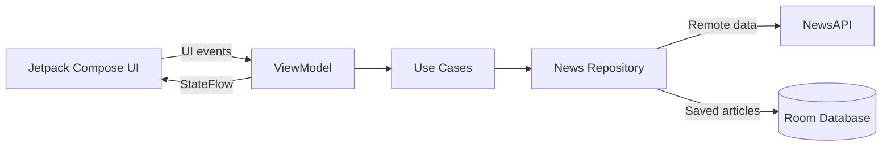

# Assaply — Android News App

Android-приложение для чтения новостей с поиском, постраничной загрузкой и локальным сохранением статей.

Приложение построено на современном Android-стеке с использованием **Kotlin, Jetpack Compose, MVVM, Hilt, Room, Paging 3 и Retrofit**.

**Kotlin · Jetpack Compose · MVVM · Clean Architecture · Hilt · Room · Paging 3 · Retrofit · Coroutines**

---

## Возможности

- просмотр новостной ленты с постраничной загрузкой;
- поиск публикаций по ключевым словам;
- просмотр подробной информации о статье;
- сохранение статей в закладки;
- удаление статей из закладок;
- офлайн-доступ к сохранённым материалам;
- навигация между экранами на Jetpack Compose;
- сохранение пользовательских настроек;
- обработка состояний загрузки и ошибок.

---

## Архитектура

Приложение построено с разделением ответственности между Presentation, Domain и Data слоями.



### Presentation

UI полностью реализован на **Jetpack Compose**.

Экраны взаимодействуют с ViewModel, а состояние UI передаётся через `StateFlow`.

Основные экраны:

- Home;
- Search;
- Details;
- Bookmarks.

Навигация реализована через `NavHost` и `NavController`.

### Domain

Domain-слой содержит use cases и отделяет UI от реализации источников данных.

Основные операции:

```text
getNews
searchNews
upsertArticle
deleteArticle
getSavedArticles
```

### Data

Репозиторий объединяет два источника данных:

```text
Remote ── NewsAPI + Retrofit + Paging 3
Local  ── Room Database
```

Благодаря этому сетевые операции и локальное хранение не зависят от UI-слоя.

---

## Получение новостей

Для получения публикаций используется **NewsAPI**.

```text
Jetpack Compose
       │
       ▼
   ViewModel
       │
       ▼
    Use Case
       │
       ▼
  Repository
       │
       ▼
 PagingSource
       │
       ▼
   Retrofit
       │
       ▼
    NewsAPI
```

Для больших списков используется **Paging 3**, поэтому приложение загружает новости постепенно по мере прокрутки, вместо загрузки всей выдачи сразу.

---

## Поиск

Поиск выполняется через NewsAPI.

Пользователь вводит запрос на экране Search, после чего:

```text
SearchScreen
     │
     ▼
SearchViewModel
     │
     ▼
SearchNews Use Case
     │
     ▼
Repository
     │
     ▼
NewsAPI
```

Результаты также загружаются постранично через Paging 3.

---

## Закладки и офлайн-доступ

Статью можно сохранить из экрана подробного просмотра.

Сохранённые материалы хранятся локально в **Room Database**:

```text
Details Screen
      │
      ▼
   ViewModel
      │
      ▼
   Use Case
      │
      ▼
 Repository
      │
      ▼
     Room
```

Для локального хранилища используются DAO-операции добавления, удаления и чтения статей.

Сохранённые статьи доступны без подключения к сети.

---

## Dependency Injection

Для внедрения зависимостей используется **Hilt**.

Через DI создаются и передаются:

```text
Retrofit
Room Database
NewsRepository
NewsUseCases
UserPreferences
```

ViewModel получают зависимости через `@HiltViewModel`.

---

## Технологии

| Задача | Технология |
| --- | --- |
| Язык | Kotlin |
| UI | Jetpack Compose |
| Архитектура | MVVM + Clean Architecture |
| Dependency Injection | Hilt |
| Работа с сетью | Retrofit |
| HTTP client | OkHttp |
| Пагинация | Paging 3 |
| Локальная БД | Room |
| Асинхронность | Kotlin Coroutines / Flow |
| Состояние UI | StateFlow |
| Изображения | Coil |
| Навигация | Jetpack Navigation Compose |
| Настройки | DataStore |

---

## Тестирование

Проект содержит unit- и instrumented-тесты для основных компонентов приложения.

Используются:

```text
JUnit
MockK
MockWebServer
Coroutines Test
Room Testing
AndroidX Test
```

Тестами покрываются компоненты API, domain-слоя, repository, ViewModel и локального хранилища.

Запустить unit-тесты:

```bash
./gradlew test
```

Запустить instrumented-тесты на подключённом устройстве или эмуляторе:

```bash
./gradlew connectedAndroidTest
```

---

## Как запустить

### Требования

- Android Studio;
- Android SDK;
- устройство или Android Emulator;
- API-ключ NewsAPI.

Минимальная поддерживаемая версия приложения:

```text
Android 8.0 / API 26
```

### 1. Получить API-ключ

Для работы приложения необходим API-ключ NewsAPI.

### 2. Добавить ключ

В корне проекта открой `local.properties` и добавь:

```properties
NEWS_API_KEY=your_api_key
```

`local.properties` не должен попадать в Git.

### 3. Запустить приложение

Открой проект в Android Studio и дождись завершения Gradle Sync.

После этого выбери устройство или эмулятор и запусти модуль:

```text
app
```

---

## Как пользоваться приложением

После запуска открывается главная лента новостей.

### Лента

На главном экране отображается список публикаций.

Новости подгружаются автоматически по мере прокрутки.

### Поиск

Перейди на экран поиска и введи интересующий запрос.

Приложение отправит запрос в NewsAPI и отобразит найденные публикации.

### Просмотр статьи

Нажатие на публикацию открывает экран с подробной информацией.

### Закладки

На экране статьи материал можно сохранить.

Сохранённые статьи отображаются на отдельном экране Bookmarks и хранятся локально в Room.

---

## Структура проекта

```text
app/src/main/java/com/example/assaply/
│
├── data/
│   ├── api/              # NewsAPI / Retrofit
│   ├── domain/           # модели и domain-логика
│   ├── repository/       # реализация репозитория
│   └── room/             # Room Database и DAO
│
├── presentation/
│   ├── common/           # общие UI-компоненты
│   ├── events/           # UI events
│   ├── navigation/       # навигация приложения
│   ├── screens/          # экраны Compose
│   ├── states/           # состояния UI
│   └── viewmodels/       # ViewModel
│
├── ui/
│   └── theme/            # тема приложения
│
├── util/                 # настройки и вспомогательные компоненты
├── AppModule.kt          # Hilt DI
├── AssaplyApp.kt
└── MainActivity.kt
```

---

## Что демонстрирует проект

Проект показывает работу с типичными задачами современной Android-разработки:

- декларативный UI на Jetpack Compose;
- MVVM и разделение приложения на слои;
- управление состоянием через Flow / StateFlow;
- Dependency Injection через Hilt;
- интеграцию с REST API;
- пагинацию больших списков;
- локальное хранение данных через Room;
- offline-сценарии;
- навигацию между Compose-экранами;
- unit- и instrumented-тестирование.